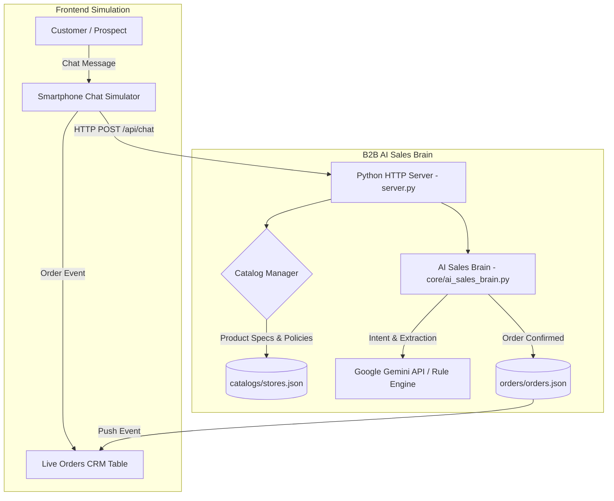

<div align="center">

# 🚀 B2B AI Sales Engine & Client Demo Sandbox
### Real-Time Conversational AI Sales Brain & Omnichannel COD Checkout Simulator for Bangladeshi E-Commerce

[](https://python.org)
[](https://ai.google.dev/)
[](https://github.com/Jubayer-ahamed42/b2b-ai-sales-engine)
[](https://opensource.org/licenses/MIT)

**Founder:** [Jubayer Ahamed](https://github.com/Jubayer-ahamed42) | **Agency:** [Be Smart With AI](https://github.com/Jubayer-ahamed42)

</div>

---

## 🌟 Overview & Strategic Value

In the Bangladeshi e-commerce landscape, over 35% of buying decisions and customer inquiries occur between 11:00 PM and 2:00 AM. Traditional SMEs and fashion brands lose thousands in revenue daily due to missed midnight leads and slow response times. Furthermore, business owners are hesitant to grant admin credentials or developer API keys to third-party consultants.

**B2B AI Sales Engine & Client Demo Sandbox** solves this dilemma. It is a zero-dependency, ultra-fast conversational commerce engine and live interactive smartphone sandbox (WhatsApp/Messenger style). It allows agencies and consultants to demonstrate automated 24/7 sales conversions, product consultations, BD 11-digit phone number validations, and real-time cash-on-delivery (COD) order extraction right in front of client prospects without touching their live pages.

---

## 🔥 Key Features

1. **Interactive Smartphone Sandbox (WhatsApp/Messenger UI)**:
   - Pixel-perfect mobile device simulator with instant conversational sales replies.
   - Accurately answers product specifications, pricing, sizing, stock availability, and delivery policies.
   - Extracts customer name, validates BD 11-digit phone numbers (`01XXXXXXXXX`), collects delivery addresses, and formats immediate COD purchase orders.
2. **Real-Time Live Orders Ledger & CRM**:
   - Synchronous order dispatching: once an order is placed in the chat, the live CRM ledger updates dynamically.
   - Provides immediate visual proof to e-commerce owners of automated revenue capture.
3. **Multi-Tenant Client Switcher**:
   - Out-of-the-box support for multiple verticals:
     - **Fashion & Panjabi**: *Aura Fashion BD*
     - **Smart Gadgets & Electronics**: *TechNova*
     - **Organic Health Food**: *Freshy Food*
   - Configurable JSON store catalogs for plug-and-play onboarding in under 2 minutes.
4. **Zero-Dependency Architecture**:
   - Runs out-of-the-box on standard Python with zero heavy pip requirements.
   - Includes 1-click Windows runner (`run_demo.bat`).

---

## 🏗️ Architecture



---

## 🚀 Quickstart Guide

### 1. Clone & Configure
```bash
git clone https://github.com/Jubayer-ahamed42/b2b-ai-sales-engine.git
cd b2b-ai-sales-engine
cp .env.example .env
```
*(Add your Google Gemini API key inside `.env` if using generative AI features, or run directly in rule-based simulation mode).*

### 2. Launch
- **Windows (1-Click)**: Double click `run_demo.bat`
- **Manual**:
  ```bash
  python server.py
  ```
The sandbox dashboard will automatically launch at `http://127.0.0.1:5050`.

---

## 🎯 Client Outreach Playbook

For step-by-step agency blueprints, outreach templates, and 2-minute conversion scripts, refer to:
👉 [**Client Outreach Playbook**](pitch_templates/OUTREACH_PLAYBOOK.md)

---

## 📁 Repository Structure

```text
├── catalogs/
│   └── stores.json            # Multi-tenant store product catalogs & policies
├── core/
│   ├── ai_sales_brain.py      # Conversational sales brain & address extraction
│   └── catalog_manager.py     # Catalog parser & store switcher
├── orders/
│   └── orders.json            # Live simulated orders ledger
├── pitch_templates/
│   └── OUTREACH_PLAYBOOK.md   # Agency client acquisition blueprint & message templates
├── static/
│   └── index.html             # Smartphone UI simulator & live CRM dashboard
├── .env.example               # Safe environment variable configuration template
├── .gitignore                 # Git ignore rules for secrets and caches
├── README.md                  # Project documentation
├── run_demo.bat               # Windows 1-click executable runner
├── server.py                  # Zero-dependency Python server
└── test_sales_engine.py       # Automated unit tests for order extraction
```

---

## 🛡️ License

Distributed under the MIT License. See [LICENSE](LICENSE) for details.

---

<div align="center">
Developed with ❤️ by <a href="https://github.com/Jubayer-ahamed42">Jubayer Ahamed</a> &middot; Empowering Bangladeshi E-Commerce with Autonomous AI
</div>
